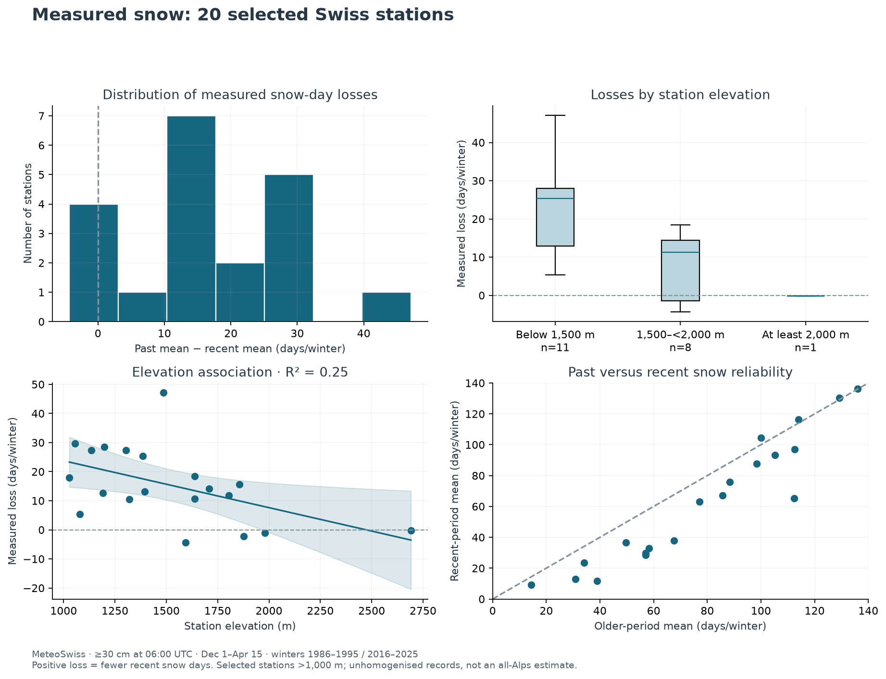
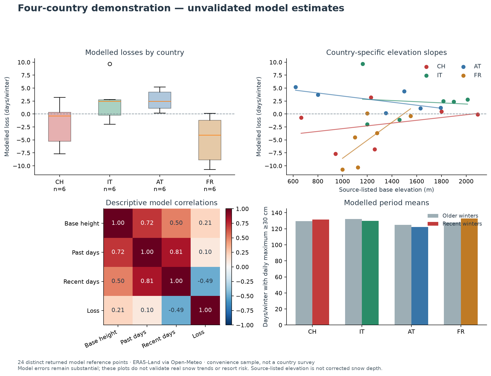
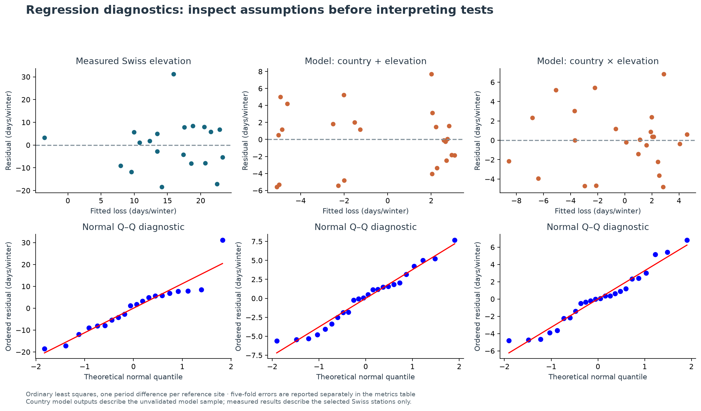
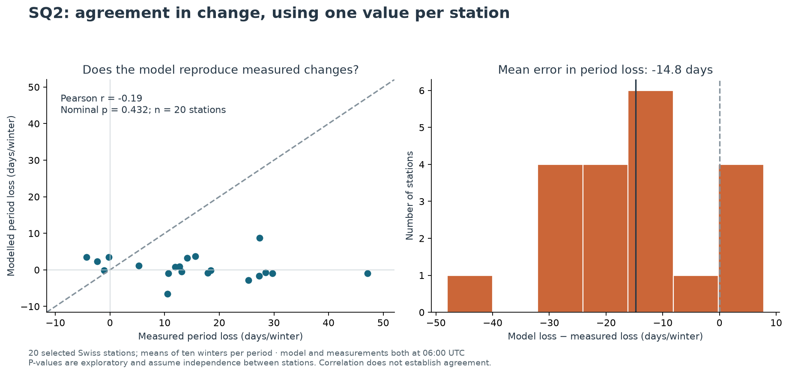
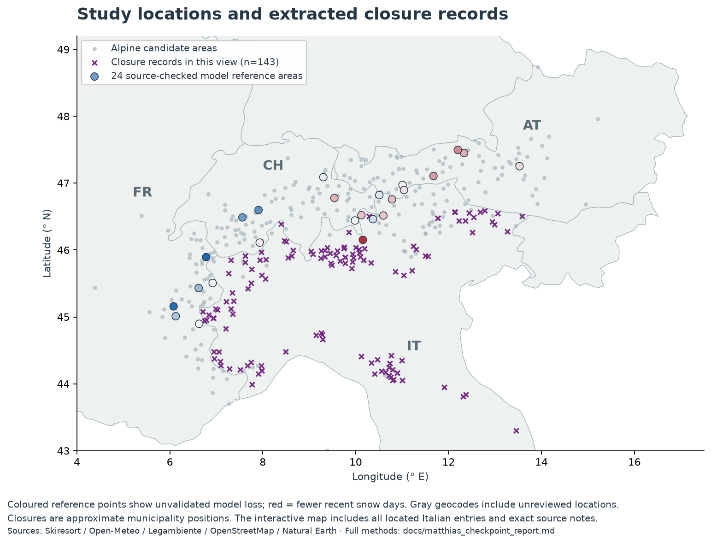

# Matthias's November 25 and December 2 checkpoint work

## What is ready

- Snow exploration: descriptive statistics, distributions, elevation groups, correlations, period comparisons and interpretation.
- An interactive map of candidate ski areas and the extracted Italian closure records, plus a static overview.
- SQ1: an elevation regression using measured Swiss records, and separate four-country model regressions with country/elevation interactions, coefficient tables, diagnostics and five-fold validation errors.
- SQ2: matched model–station errors, Pearson/Spearman comparisons of station changes, a paired change-error test and station-resampled uncertainty.
- The old pilot IDs mapped to current source IDs, integration into qualified SQLite tables, and reproducible notebooks/code.

**Scope:** the measured climate result covers 20 selected Swiss stations. The country comparison is a **24-area unvalidated ERA5-Land demonstration**, six named areas per country, not the original full Alpine sample. The code/analytical deliverables are implemented; reliable all-resort country conclusions and risk classes are not established. The original four-country question is unchanged.

## The measured result in simple words

These Swiss stations averaged **78.3 snow days in the older period and 63.0 recently: 15.4 fewer days per winter**.

Within this selected sample, an extra 100 m of elevation is associated with **1.61 fewer days of loss**. The coefficient is -1.612 days per 100 m, with nominal 95% CI [-2.977, -0.246] and p = 0.0233. This is an association, not proof that altitude caused the difference. Site histories, spatial dependence and the station selection limit inference.

## SQ1: regressions and predictive checks

The outcome is the older ten-winter mean minus the recent ten-winter mean. Positive values mean fewer recent snow days. Elevation is centred at 1,500 m and measured in units of 100 m. The observed model has one row per station, not 400 independent rows. Its country term cannot be estimated because all its stations are Swiss.

The model demonstration has 24 reviewed access-point locations and 480 complete resort winters. It contains 24 distinct returned weather-model points for the regressions. Shared model points, if any, are represented once. The sample was selected by named areas and elevation coverage before downloading snow outcomes. It is a convenience sample, not a representative country sample. Cross-border source systems are excluded.

For the country models, Switzerland is the reference. A country intercept contrast refers to 1,500 m; an interaction is the difference in slope per 100 m from Switzerland. Country-specific lines are drawn only inside each country's sampled elevation range. Classical tests are exploratory; geographic dependence and the small sample limit their interpretation.

| model_id | n_reference_sites | r_squared | adjusted_r_squared | rmse_5fold_days | rmse_5fold_training_mean_days |
| --- | --- | --- | --- | --- | --- |
| Measured Swiss: elevation | 20 | 0.255 | 0.213 | 11.635 | 12.843 |
| Model sample: elevation + country | 24 | 0.439 | 0.321 | 4.404 | 5.106 |
| Model sample: elevation × country | 24 | 0.573 | 0.387 | 4.945 | 5.106 |

Five-fold predictions are produced by fitting on the other folds. Country folds are stratified; the measured Swiss folds are shuffled station folds. The baseline predicts the training-fold mean. A model that does not improve on this baseline has weak predictive value, even if in-sample R² is positive. In this run, interactions raise in-sample R² from 0.439 to 0.573, while five-fold RMSE changes from 4.40 to 4.95 days. The more complex fit is therefore not automatically the better predictor. The measured elevation model has five-fold RMSE 11.63 days versus 12.84 for the training-mean baseline.

Only one measured station lies at or above 2,000 m. We show it descriptively but do not calculate a three-band measured ANOVA with a one-station group. The pre-specified below/at-least-1,500 m comparison has 11 and 9 stations and is reported separately. Detailed coefficients, nominal intervals/p-values, ANOVA and the interaction test are in `data/processed/snow_checkpoint_*.csv`.

## SQ2: do the model estimates agree with the measurements?

The original complete 400-case comparison overcounts snow by **54.2 days per winter on average**. The mean measured loss is 15.4 days, versus 0.6 modelled days. A model can produce complete data while missing the measured changes.

| comparison | method | n_station_units | statistic | p_value_nominal |
| --- | --- | --- | --- | --- |
| station_period_loss | Pearson | 20 | -0.18631 | 0.43159 |
| station_period_loss | Spearman | 20 | -0.37411 | 0.10417 |
| station_mean_snow_days | Pearson | 20 | 0.34502 | 0.13627 |
| station_mean_snow_days | Spearman | 20 | 0.34913 | 0.13135 |
| model_minus_observed_period_loss | paired_t_test | 20 | -4.77999 | 0.00013 |

These tests use one value per station (n=20), not 400 independent locations. Pearson and Spearman describe association; neither establishes agreement. A non-significant correlation is not proof of no relationship, and a paired mean-error test does not validate individual predictions. The observed/model change patterns remain poorly matched. The station bootstrap resamples whole station summaries, retains the repeated-winter structure, and still does not eliminate spatial dependence or make these records homogenised climate series.

**Consequences:** use the Swiss measured result as a stated subset. Treat country-model outputs as a demonstration and sensitivity check. Do not promote their 100-day categories to validated natural-snow risk, a calibrated price determinant, or evidence that snow conditions caused lift closures.

## Map and coverage

Open [the standalone interactive map](ski_resorts_closures_map.html) after downloading it, or run the new notebook to view it. Leaflet/jQuery are bundled and the default outlines do not require a tile service.

- 275 Alpine candidate areas are shown. The 24 study locations were checked against listed Skiresort lift-access points; some other candidate geocodes still need review. An access-point location does not certify snow depth at the minimum ski elevation.
- **181/184 extracted closure records** have approximate municipality/locality positions. The remaining 3 ambiguous records are retained in `closure_locations_unresolved.csv` and are not plotted. Search aliases and their reasons are explicit; source municipality wording is preserved.
- Purple/brown points represent abandoned/temporarily closed facilities. Several facilities may share a municipality point. Positions identify municipalities/localities, not individual lift GPS coordinates.
- The closure table is the group's **184-record extracted sample**, not a complete census of Italian closures. It includes places outside the Alps, shown in the interactive map.
- The model-change layer and optional Swiss-measurement layer have distinct source/time definitions. Model resort counts use a daily maximum; measured station counts and the model–station comparison use 06:00 UTC.

## IDs and database handover to Luca

All 10 original pilot entries now have a documented current canonical ID, covering 9 source areas. Zermatt and Cervinia remain two gateways of one connected cross-border system. Preserve their gateway information; do not count them as independent ski areas.

| join | input_rows | output_rows | lost_rows | distinct_canonical_areas | note |
| --- | --- | --- | --- | --- | --- |
| pilot entries to canonical area IDs | 10 | 10 | 0 | 9 | Zermatt and Cervinia remain two gateways of one connected area |
| model reference areas to canonical roster | 24 | 24 | 0 | 24 | one summary per source area; unvalidated snow model |

New tables in `db/sci_alpi.db` have the `checkpoint_` prefix, plus `pilot_resort_id_crosswalk`. Original team tables are preserved. The 24 model summaries join one-to-one to `resort_roster`; do not join them naively to duplicate price-market rows. `checkpoint_data_quality` records the limits. No validated `risk_class` was generated and no original snow table was silently replaced.

The notebook displays SQLite JOIN/GROUP BY results. The new CSVs and qualified SQLite tables are documented for Luca's PostgreSQL handover; the existing PostgreSQL loader has not been extended or tested for these additional tables here. Lorenzo's missing lift counts / snowmaking values and the team's exchange-rate decision remain separate tasks in Luca's latest summary.

## Reproduction and remaining scientific limits

Open `notebooks/03.3_matthias_checkpoints.ipynb` and choose Run All. Saved results are included. The default run has no API download. `python src/run_snow_checkpoints.py` rebuilds tables, figures, map, report and qualified SQLite tables from the committed inputs.

Download commands are explicit and cached: `python src/checkpoint_sample.py --prepare --download` and `python src/closure_locations.py --download`. Use the original documented API limits; a failed batch preserves published outputs. Model responses are checked for exact hourly seasons, finite non-negative snow in metres and correct UTC dates/settings; missing values never become zero-snow days.

A metadata screen of the ECA&D snow archive found no Italian station above 1,000 m that spanned both target endpoints in the reviewed catalogue. We did not silently shorten 2016–2025 to fit the alternative archive. This endpoint screen is not itself a daily-completeness validation. Audit: `alternative_station_coverage_audit.csv`.

Direct CERRA retrieval remains prepared but untested without a CDS account/key and dataset-licence acceptance. The public CERRA probe is missing winter 2025. Even a newer product needs matched validation before interpreting country effects or risk labels. The original full-resort scientific conclusions therefore remain open despite the completed checkpoint analysis workflow.

## Sources

- Team task plan (25 November EDA/map; 2 December SQ1/SQ2): https://drive.google.com/file/d/1KOdo6FT4GiZrn5h4tROa-_DfBwYe2cCg/view
- Luca's updated shared task summary, read 25 November: https://docs.google.com/document/d/19o67hhBiRbzieY01oCaL3jXeIBkxtnrU1EbvMDoKJGo/edit
- Skiresort access-page URLs and hashes: `checkpoint_resorts_24.csv`; original resort roster and source records are preserved.
- Open-Meteo Historical API, ECMWF/Copernicus ERA5-Land: https://open-meteo.com/en/docs/historical-weather-api ; individual query URLs/hashes are in the model panel.
- MeteoSwiss measurement metadata: https://opendatadocs.meteoswiss.ch/a-data-groundbased/a5-manual-precipitation-stations ; `hto000d0` is morning depth in cm.
- Legambiente Nevediversa 2026: original group extraction and page references in `legambiente_closures.csv`; geocoding via https://nominatim.openstreetmap.org and © OpenStreetMap contributors, ODbL.
- Natural Earth country outlines, public domain; Leaflet, BSD-2-Clause; jQuery/Folium, MIT. Bundled map assets retain their licence texts.
- ECA&D station/source catalogue: https://www.ecad.eu/dailydata/predefinedseries.php ; Klein Tank et al. (2002), International Journal of Climatology 22, 1441–1453. Used here for the availability audit, not for invented observations.
