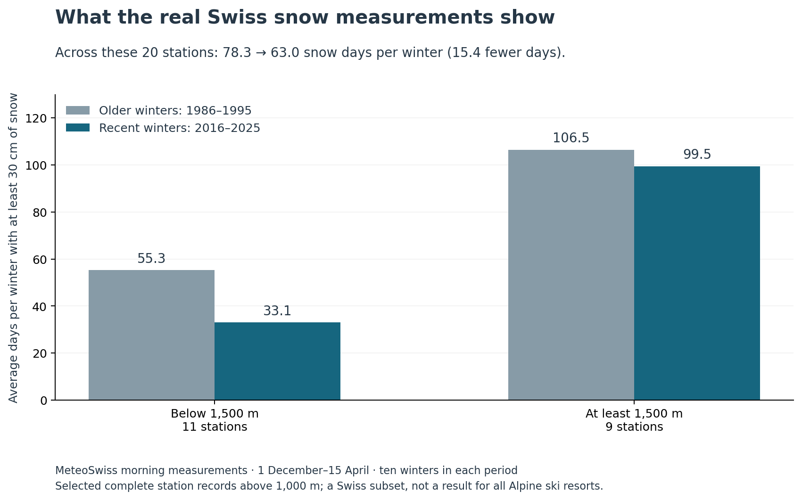

# Matthias's snow work: the simple version

**Our question:** do ski areas have fewer days with enough natural snow now than before? We define enough snow as at least 30 cm, and compare winters ending in 1986–1995 with those ending in 2016–2025.

There are two sources of snow information: **measurements taken on the ground**, and **estimates from a computer weather model**. We checked whether those estimates agree with the measurements before using them for all the resorts.

## What the real measurements show

| Selected Swiss stations | Average days before | Average days recently | Fewer days |
| --- | ---: | ---: | ---: |
| Below 1,500 m (11 stations) | 55.3 | 33.1 | 22.3 |
| At least 1,500 m (9 stations) | 106.5 | 99.5 | 7.0 |

Across all 20 stations, the average fell from 78.3 to 63.0 days per winter: **15.4 fewer days**. Lower stations in this sample lost more days on average.

## Why the computer estimates need more work

The model counts much more snow than the stations measure, and it shows little of their change between the two periods. Choosing the closest model point did not improve our small follow-up test. Entering an altitude also does not automatically give snow depth at that exact height.

**We have a useful result:** the actual station records show fewer snow days in this sample, and the model check reveals an important data-quality limitation. These findings can be presented to the group.

## What comes next

The original project covers four countries. We still need a suitable snow method for that comparison and a reviewed set of resort locations. The current measured result covers **20 selected Swiss stations above 1,000 m**, not all Alpine resorts. Station-history changes remain a limitation; these are not certified homogenised climate records.

The code, tables and charts are prepared. Open `notebooks/03.2_snow_analysis.ipynb` on the pull-request branch and choose Run All to view the saved results. The details and source links are in [the method check](snow_method_check.md) and [the full validation](matthias_next_steps.md).
