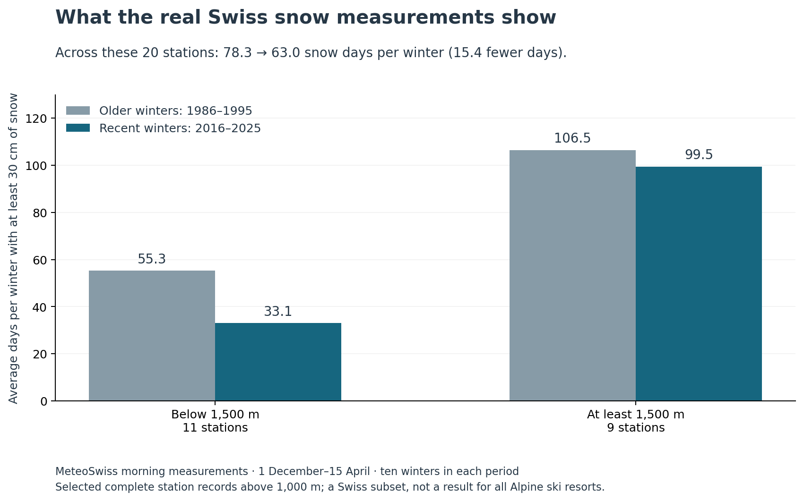

# Measured snow summary and location-selection method check

## What are we trying to find out?

We want to count how many days have enough natural snow, then compare older winters with recent winters. For this project, enough snow means at least 30 cm. We count days from 1 December to 15 April.

## What have we done?

1. Collected snow estimates from a computer weather model for the ten-resort pilot.
2. Collected actual snow measurements from 20 Swiss stations.
3. Checked whether the computer estimates agree with the measurements at those stations.
4. Prepared a comparison of older and recent winters using the measurements themselves.

The measurements are readings taken on the ground. The model estimates conditions over larger areas. They are not the same source of information.

## What do the real measurements show?

These are averages for the selected Swiss stations, using 06:00 UTC measurements in winters ending 1986–1995 and 2016–2025.

| Station group | Stations | Older period | Recent period | Fewer snow days |
| --- | ---: | ---: | ---: | ---: |
| All selected stations | 20 | 78.3 | 63.0 | 15.4 |
| Below 1,500 m | 11 | 55.3 | 33.1 | 22.3 |
| At least 1,500 m | 9 | 106.5 | 99.5 | 7.0 |

The lower stations in this sample lost more snow days on average. This is a description of these 20 Swiss station records. It does not yet establish what happened in all resorts or in Italy, Austria and France, nor does it prove that elevation caused the difference. The series are not certified homogenised climate records, so site-history changes remain a limitation.

## Why can't we simply use the weather estimates for all resorts?

The matched 400-case check showed that the model counts too many snow days and reproduces little of the measured change between the two periods. A program can run successfully while its input estimates are unsuitable for the conclusion we want to draw.

The follow-up tested one possible explanation: whether choosing the closest weather-model point helps. The test used **all 20 stations and the two existing pilot winters, 1995 and 2025**. It changed only the point-selection setting. The original option overcounted by 49.4 days on average; the closest-point option overcounted by 53.2. It did not improve this pilot comparison. This is a 40-case sensitivity check, not a new 20-winter climate result.

There is also an altitude limitation. The provider's code does not mark snow depth for elevation correction. Entering a resort's altitude can influence which model point is selected, but does not establish snow depth at that exact height. Therefore the original base-versus-summit test is a point-selection sensitivity check, not a measured comparison of snow at the bottom and top of the resort.

A separate diagnostic queried four already-selected grid points with downscaling disabled (`elevation=nan`) for 1 January 2025. For Davos, the station is at 1,594 m while the API then reports 2,088 m; Weissfluhjoch is at 2,691 m and shares that same returned model point. The retained original responses give identical hourly model snow-depth sequences for those two stations in all 20 study winters. Their actual measured records are different. See `snow_grid_elevation_examples.csv`. This illustrates the spatial/elevation limitation; it is not a complete physical explanation for every model error, and the four illustrative probes are not another climate validation sample.

We have not identified every physical cause of the model errors. These checks rule out an easy fix by choosing the closest point or assuming the altitude parameter adjusts snow depth. A universal subtraction of the average error would not fix the model's different pattern of change.

## What can the group use now?

- A measured result for the 20-station Swiss subset: fewer snow days on average, with a larger average loss at lower stations in this sample.
- A completed data-quality result: the raw weather-model estimates do not reproduce those station changes well.
- Tables, a simple before/after chart, the detailed comparison figures, and a station map.

## What remains for the original four-country study?

The follow-up now has a separate 293-area climate roster, with one row per source URL. All 33 flagged identities (40 original rows) were checked against source access pages. Eighteen areas are outside the Alps and are excluded from the 275-area candidate set. Five cross-border areas have their own category. The other 260 identities have not been individually rechecked, and the listed access points are not certified minimum-elevation snow sites. Lorenzo's original rows are preserved. See [the expansion status](snow_expansion_status.md).

After the snow method and locations are agreed, the remaining work is to expand the download, compare countries and elevations, and connect the snow results to the price and closure analyses. The original four-country conclusions remain open; we have not silently changed the research question to Switzerland alone.

## Where to look

Open `notebooks/03.2_snow_analysis.ipynb` on the main branch and choose Run All. The saved results are already included, so it does not need to download the weather data again. Start with `docs/matthias_simple_explanation.md` for the short explanation. `docs/matthias_next_steps.md` contains the full-panel diagnostics.

## Sources and reproduction

- Measurements: the committed `meteoswiss_station_winters.csv`, originally counted from MeteoSwiss daily files. Parameter `hto000d0`: morning snow depth at 06:00 UTC, in cm. https://opendatadocs.meteoswiss.ch/a-data-groundbased/a5-manual-precipitation-stations
- Weather API: https://open-meteo.com/en/docs/historical-weather-api. The provider documents snow depth in metres and warns about overestimated ERA5-Land snow depth. The project compares 0.30 m to 30 cm.
- Elevation-correction check: `isElevationCorrectable` in the provider's variable definitions, pinned source revision `6d7e23e81efdc4687c06ec4137822d43f9fdda6f`: https://github.com/open-meteo/open-meteo/blob/6d7e23e81efdc4687c06ec4137822d43f9fdda6f/Sources/App/Era5/Era5Variables.swift#L399-L403. It lists temperature-related variables, not snow depth. This supports the limitation above; it does not by itself diagnose every source of snow-model bias.
- `snow_grid_selection_pilot.csv` and `snow_grid_selection_metrics.csv` retain the two-setting comparison. The original 400-case validation is preserved separately. To reproduce missing closest-point pilot responses: `python src/snow_method_check.py`. To rebuild this measured summary and page from saved data: `python src/snow_plain_summary.py`.
